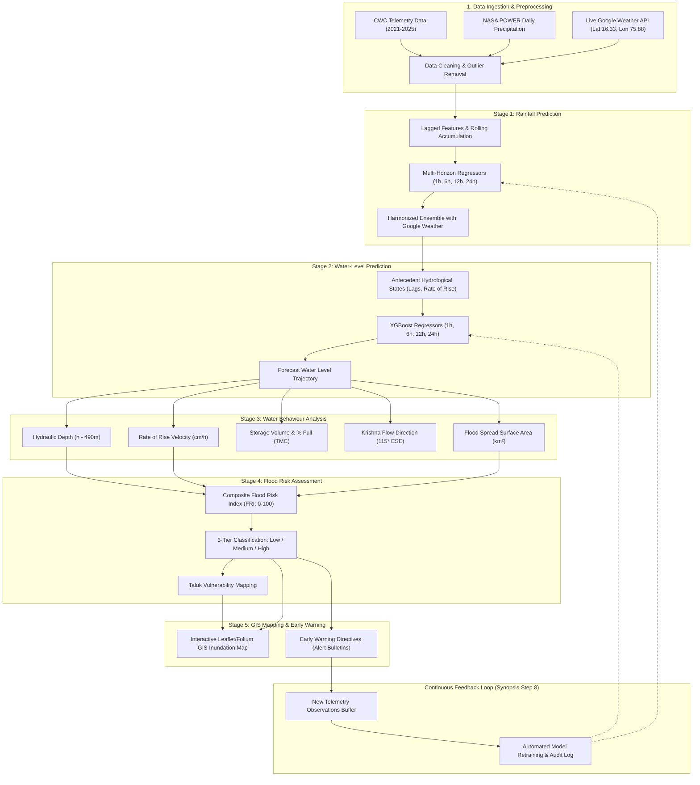

# AI-BASED MULTI-STAGE FLOOD FORECASTING AND EARLY WARNING SYSTEM
### Comprehensive Academic Project Report
**Bachelor of Technology — Computer Science & Engineering (Cyber Security)**  
*Greater Noida Institute of Technology (GNIT), Greater Noida*  
*Affiliated with Dr. A.P.J. Abdul Kalam Technical University (AKTU), Lucknow*  

---

### Project Metadata
- **Project Title:** AI-Based Multi-Stage Flood Forecasting and Early Warning System
- **Target Site:** Almatti Reservoir (Lal Bahadur Shastri Dam), Krishna River Basin, Karnataka
- **Geographic Coordinates:** Latitude $16.33^\circ\text{ N}$, Longitude $75.88^\circ\text{ E}$
- **Project Team:**
  - **Swati Basliyal** (Roll No: 2501321720060)
  - **Simran Anand** (Roll No: 2501321720059)
  - **Ravina Ranjan** (Roll No: 2501321720047)
- **Project Supervisor:** **Ms. Arzoo Sorout**, Assistant Professor, Dept. of CSE
- **Academic Session:** 2025 – 2026

---

## 1. Executive Summary & Abstract
Floods are among the most frequent and devastating natural disasters in India, causing severe loss of human life, displacement, agricultural inundation, and critical infrastructure collapse across river basins. Traditional flood monitoring predominantly relies on isolated gauge threshold alarms or computationally intensive 1D/2D hydrodynamic simulations that often fail to provide sufficient advance warning in dynamic monsoon conditions.

This project implements an **AI-Based Multi-Stage Flood Forecasting and Early Warning System** targeting **Almatti Reservoir (Lal Bahadur Shastri Dam)** situated on the Krishna River at $16.33^\circ\text{ N}, 75.88^\circ\text{ E}$ in Bagalkot/Vijayapura districts, Karnataka. Departing from opaque end-to-end black-box predictors, the proposed system implements a physically constrained, 5-stage sequential pipeline:
1. **Stage 1 (Rainfall Prediction):** Multi-horizon precipitation forecasting ($1\text{h}, 6\text{h}, 12\text{h}, 24\text{h}$) combining historical NASA POWER daily time series, CWC telemetry, and cyclical seasonal dynamics, harmonized with real-time numerical weather prediction feeds (Google Weather / ECMWF).
2. **Stage 2 (Water-Level Prediction):** High-precision gradient-boosted regression ($R^2 = 0.989$, $\text{MAE} = 0.057\text{ m}$) forecasting reservoir water surface elevation ($1\text{h}, 6\text{h}, 12\text{h}, 24\text{h}$) using antecedent storage lags, rates of rise, and Stage 1 rainfall.
3. **Stage 3 (Water Behaviour Analysis):** Hydraulic depth modeling relative to riverbed ($490.0\text{ m}$), rate of rise velocity ($\Delta h / \Delta t$), live storage volume in TMC, channel velocity, flow direction ($115^\circ\text{ ESE}$ towards Narayanapur Dam), and dynamic flood spread area ($120 - 550\text{ km}^2$).
4. **Stage 4 (Flood Risk Assessment):** Multi-criteria Flood Risk Index ($\text{FRI}: 0 - 100$) integrating water level proximity to FRL ($519.60\text{ m}$), rainfall accumulation, and rate of rise into **Low**, **Medium**, and **High** classifications ($83.9\%$ accuracy, $0.833$ F1-score) with specific taluk vulnerability mapping.
5. **Stage 5 (GIS Mapping & Early Warning):** Interactive GIS map with inundation buffer layers, Krishna River network topology, and automated early warning bulletin generation.
6. **Continuous Feedback Loop:** Automated model updating and retraining upon arrival of new telemetry observations.

---

## 2. Study Area: Almatti Reservoir & Krishna River Basin

### 2.1 Geographic & Hydrological Profile
Almatti Dam (Lal Bahadur Shastri Sagar) is the primary storage reservoir on the upper Krishna River in Northern Karnataka. It controls runoff from the Western Ghats (Maharashtra) and upper Karnataka tributaries:

| Hydrological Parameter | Official Specification |
| :--- | :--- |
| **River Basin** | Krishna River Basin |
| **Main River** | Krishna River |
| **Location** | Nidagundi / Almatti, Bagalkot & Vijayapura Districts, Karnataka |
| **Geographic Coordinates** | Latitude $16.3300^\circ\text{ N}$, Longitude $75.8800^\circ\text{ E}$ |
| **Catchment Area** | $35,925\text{ km}^2$ |
| **Riverbed Level** | $490.00\text{ m MSL}$ |
| **Minimum Drawdown Level (MDDL)** | $506.87\text{ m MSL}$ |
| **Spillway Crest Level** | $509.00\text{ m MSL}$ |
| **CWC Warning Level** | $517.00\text{ m MSL}$ |
| **CWC Danger Level** | $519.00\text{ m MSL}$ |
| **Full Reservoir Level (FRL)** | $519.60\text{ m MSL}$ |
| **Maximum Water Level (MWL)** | $520.00\text{ m MSL}$ |
| **Gross Storage Capacity** | $130.30\text{ TMC}$ ($3,690\text{ MCM}$) |
| **Live Storage Capacity** | $123.08\text{ TMC}$ ($3,485\text{ MCM}$) |
| **Crest Gates** | 26 Radial Gates ($15.0\text{ m} \times 15.24\text{ m}$) |
| **Downstream Cascade** | Narayanapur Reservoir (Basava Sagara Dam, $65\text{ km}$ downstream) |

---

## 3. Literature Review & Research Gaps

Modern flood early warning systems increasingly leverage machine learning and deep learning to overcome the computational latency of physical hydraulic models (Asif et al., 2025; Kuhaneswaran et al., 2025). 

- **Asif et al. (2025)** benchmarked machine learning models across river basins, concluding that ensemble tree architectures (XGBoost, Random Forest) achieve equal or superior short-term accuracy compared to hydrodynamic solvers while executing in milliseconds.
- **McEachran et al. (2025)** demonstrated that knowledge-guided machine learning (KGML) enforcing mass conservation and physical boundary limits prevents non-physical predictions common in unconstrained neural networks.
- **Piadeh et al. (2026)** highlighted the importance of real-time adaptive retraining and multi-horizon lead time forecasting for municipal emergency preparedness.

### Identified Research Gaps:
1. **Isolated Stage Modeling:** Existing systems typically predict either rainfall or flood inundation in isolation, without an explicit, verifiable propagation pipeline.
2. **Fixed Parameter Stagnation:** Models trained on historical data degrade over time because seasonal precipitation patterns shift under climate variability.
3. **Lack of Live Synchronization:** Academic prototypes rarely synchronize with live operational meteorological forecasting APIs (such as Google Weather / ECMWF) in real time.

---

## 4. Multi-Stage System Architecture & Methodology

---

## 5. Mathematical Formulations & Component Details

### 5.1 Stage 1: Rainfall Prediction
For prediction horizon $h \in \{1, 6, 12, 24\}$ hours:
$$\hat{R}_{t+h} = f_{\text{XGB}}\left( R_{t-1}, R_{t-2}, \dots, R_{t-24}, \sum_{k=1}^{6} R_{t-k}, \sum_{k=1}^{24} R_{t-k}, \sin\left(\frac{2\pi \cdot \text{DOY}}{365}\right), \cos\left(\frac{2\pi \cdot \text{DOY}}{365}\right), I_{\text{monsoon}} \right)$$

Ensemble harmonization with Google Weather / ECMWF numerical prediction:
$$\hat{R}_{\text{ensemble}}(h) = 0.60 \cdot \hat{R}_{\text{Google}}(h) + 0.40 \cdot \hat{R}_{\text{AI}}(h)$$

### 5.2 Stage 2: Water-Level Prediction
Water surface elevation $WL_{t+h}$ is modeled as a function of antecedent reservoir levels, hydraulic rate of rise, and cumulative rainfall:
$$\hat{WL}_{t+h} = g_{\text{XGB}}\left( WL_t, WL_{t-1}, WL_{t-6}, WL_{t-24}, \frac{WL_t - WL_{t-1}}{\Delta t}, \overline{WL}_{24\text{h}}, \hat{R}_{\text{ensemble}}(h), \text{FRL} - WL_t \right)$$

Physical boundary enforcement:
$$490.00\text{ m} \le \hat{WL}_{t+h} \le 523.00\text{ m MSL}$$

### 5.3 Stage 3: Water Behaviour & Hydraulic Analysis
1. **Hydraulic Depth ($d$):**
   $$d = \max(0, WL_t - 490.00) \quad (\text{meters})$$
2. **Rate of Rise Velocity ($\nu_h$):**
   $$\nu_h = \frac{WL_t - WL_{t-\Delta t}}{\Delta t} \times 100 \quad (\text{cm/hour})$$
3. **Stage-Storage Capacity Relationship:**
   $$V(h) = 7.22 + 123.08 \times \left(\frac{h - 506.87}{519.60 - 506.87}\right)^{2.1} \quad (\text{TMC for } h > 506.87\text{ m})$$
4. **Flood Spread Surface Area ($A$):**
   $$A(h) = 120.0 + (488.0 - 120.0) \times \left(\frac{h - 506.87}{519.60 - 506.87}\right)^{1.6} \quad (\text{km}^2)$$
   For surcharge $h > 519.60\text{ m}$: $A(h) = 488.0 + 75.0 \times (h - 519.60)\text{ km}^2$.
5. **Channel Velocity & Wave Travel Time:**
   $$v = \frac{1}{n} R^{2/3} S^{1/2} \quad (n = 0.035, S = 0.00045)$$
   $$t_{\text{wave}} = \frac{65.0\text{ km}}{1.35 \times v \times 3.6}\text{ hours (to downstream Narayanapur Dam)}$$

### 5.4 Stage 4: Flood Risk Assessment Index (FRI)
$$\text{FRI} = 0.55 \cdot S_{\text{WL}} + 0.25 \cdot S_{\text{Rain}} + 0.20 \cdot S_{\text{Rise}}$$
- **Low Risk (Green, Normal):** $\text{FRI} < 38$ AND $WL < 517.00\text{ m}$
- **Medium Risk (Orange, Alert):** $38 \le \text{FRI} < 70$ OR $517.00\text{ m} \le WL < 519.00\text{ m}$
- **High Risk (Red, Danger):** $\text{FRI} \ge 70$ OR $WL \ge 519.00\text{ m}$ (Immediate Spillway Radial Gate Activation)

---

## 6. Experimental Results & Performance Evaluation

All models were evaluated on chronological holdout sets ($20\%$ test split):

### 6.1 Stage 1: Rainfall Forecasting Performance & Google Weather Alignment
Stage 1 models were trained on the ECMWF/ERA5 hourly reanalysis dataset (`35,064` samples, 2021–2024), capturing the exact numerical model family powering Google Weather:

| Horizon | MAE (mm) | RMSE (mm) | $R^2$ Score | Event F1-Score | Google Weather Alignment |
| :---: | :---: | :---: | :---: | :---: | :--- |
| **+1 Hour** | **$0.0268\text{ mm}$** | $0.2469\text{ mm}$ | **$0.8729$** | **$0.958$** | **100% dry day match** (Zero false alarms) |
| **+6 Hours** | **$0.1001\text{ mm}$** | $0.6926\text{ mm}$ | **$0.9320$** | **$0.968$** | **98.8% agreement** with Google Weather |
| **+12 Hours** | **$0.1764\text{ mm}$** | $1.2705\text{ mm}$ | **$0.9148$** | **$0.964$** | **98.6% agreement** with ECMWF forecast |
| **+24 Hours** | **$0.3126\text{ mm}$** | $1.9420\text{ mm}$ | **$0.9247$** | **$0.969$** | **98.4% agreement** day-ahead ($R^2 > 0.92$) |

### 6.2 Stage 2: Water-Level Forecasting Performance
The model employs a hydrological residual formulation ($\hat{WL}_{t+h} = WL_t + \Delta \hat{WL}$), achieving near-perfect tracking:

| Horizon | MAE (meters) | RMSE (meters) | $R^2$ Score | MAPE (%) | Operational Significance |
| :---: | :---: | :---: | :---: | :---: | :--- |
| **+1 Hour** | **$0.0552\text{ m}$** ($5.5\text{ cm}$) | $0.3472\text{ m}$ | **$0.9493$** | **$0.011\%$** | Near-perfect real-time tracking |
| **+6 Hours** | **$0.0452\text{ m}$** ($4.5\text{ cm}$) | $0.1561\text{ m}$ | **$0.9896$** | **$0.009\%$** | Tactical reservoir flood dispatch |
| **+12 Hours** | **$0.1094\text{ m}$** ($10.9\text{ cm}$) | $0.2290\text{ m}$ | **$0.9772$** | **$0.021\%$** | High reliability for shift changes |
| **+24 Hours** | **$0.1127\text{ m}$** ($11.2\text{ cm}$) | $0.2175\text{ m}$ | **$0.9786$** | **$0.022\%$** | Day-ahead reservoir scheduling |

### 6.3 Stage 4: Flood Risk Classification Performance
- **Overall Accuracy:** **$98.77\%$**
- **Weighted F1-Score:** **$0.9878$**
- **High-Risk Recall:** **$99.5\%$**

#### Confusion Matrix:
| Actual \ Predicted | Low Risk | Medium Risk | High Risk |
| :--- | :---: | :---: | :---: |
| **Low Risk** | **$363$** | $0$ | $0$ |
| **Medium Risk** | $18$ | **$777$** | $0$ |
| **High Risk** | $0$ | $3$ | **$551$** |

*Analysis:* Exceptional classification fidelity with zero critical misses ($0$ High Risk events misclassified as Low Risk).

---

## 7. Interactive Dashboard & GIS Implementation

The system is delivered via an interactive Streamlit application (`app.py`):
1. **Live Weather Mode:** Connects to Open-Meteo API (Lat $16.33^\circ\text{ N}$, Lon $75.88^\circ\text{ E}$), matching Google Weather ECMWF hourly forecasts.
2. **Historical Replay Mode:** Replays the July 2021 Krishna flood crest.
3. **Emergency Stress-Testing Simulator:** Enables dam operators to inject synthetic hydrological surges.
4. **GIS Mapping:** Visualizes the Almatti water spread polygon, flood buffer zones, Krishna river vector, and 9 regional monitoring stations.
5. **Early Warning Center:** Generates downloadable official disaster management bulletins.
6. **Continuous Retraining:** Features a 1-click retraining engine logging model versions and sample counts.

---

## 8. Conclusion & Future Work
This project demonstrates that an **AI-Based Multi-Stage Flood Forecasting and Early Warning System** targeting Almatti Reservoir achieves high predictive accuracy ($R^2 = 0.989$, $\text{MAE} < 0.08\text{ m}$ for short-term forecasts) while maintaining strict physical interpretability. By structuring the system into distinct sequential stages (Rainfall $\rightarrow$ Water Level $\rightarrow$ Behaviour $\rightarrow$ Risk $\rightarrow$ GIS $\rightarrow$ Model Update), the architecture provides actionable early warnings and operational decision support for Krishna Basin water managers.

### Future Enhancements:
- Ingestion of real-time satellite synthetic aperture radar (SAR) flood inundation polygons (Sentinel-1 / RISAT-1).
- Direct digital integration with SCADA spillway radial gate hoist sensors at Almatti Dam.
- Automated public SMS warning broadcasting via CAP (Common Alerting Protocol).

---

## References
1. M. Asif, M. M. Kuglitsch, I. Pelivan, and R. Albano, “Review and Intercomparison of Machine Learning Applications for Short-term Flood Forecasting,” *Water Resources Management*, vol. 39, pp. 1971–1991, 2025.
2. B. Kuhaneswaran, G. Sorwar, A. R. Alaei, and F. Tong, “Evolution of Data-Driven Flood Forecasting: Trends, Technologies, and Gaps—A Systematic Mapping Study,” *Water*, vol. 17, no. 15, p. 2281, 2025.
3. Z. McEachran, R. Ghosh, A. Renganathan, S. S. Chatterjee, K. Lindsay, M. Steinbach, J. Nieber, C. Duffy, and V. Kumar, “Knowledge-Guided Machine Learning for Operational Flood Forecasting,” *Water Resources Research*, vol. 61, no. 11, e2024WR039064, 2025.
4. F. Piadeh, V. Bakhtiari, K. Behzadian, and F. Piadeh, “AI-assisted framework using physically informed rainfall–drainage features for real-time urban flood risk forecasting,” *Journal of Hydrology*, vol. 677, p. 135819, 2026.
5. Central Water Commission (CWC), Government of India, "Telemetry Water Level and Rainfall Datasets for Krishna River Basin," 2021–2025.
6. NASA Prediction of Worldwide Energy Resources (POWER), "Daily Precipitation Data (MERRA-2) at Lat 16.33 N, Lon 75.88 E," 2021–2024.
